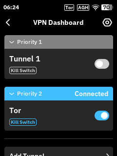
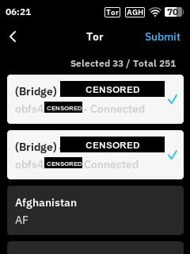
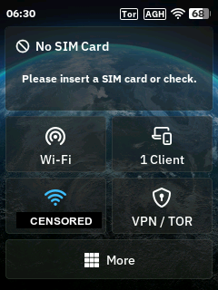
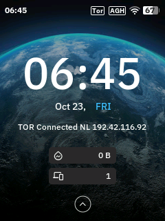

# mudi7-tor: Tor on the GL.iNet Mudi 7 touchscreen

[](CHANGELOG.md)
[](#requirements)
[](#requirements)
[](#tests)
[](LICENSE)

Turn Tor on and off, pick obfs4 bridges and exit countries, and see the Tor
exit on the lock screen, all from the touchscreen of the GL.iNet Mudi 7
(GL-E5800) 5G travel router. The stock firmware puts Tor in the web admin
panel only; this add-on brings it to the screen you already carry.

> [!WARNING]
> **For advanced users.** This add-on replaces files in the router's firmware
> over SSH as root. You need to be at ease with OpenWrt, SSH and Tor, and you
> need to know how to reflash the firmware if the router stops working.
> Use it at your own risk. I give no warranty and take no responsibility for a
> bricked router, lost data, a leaked connection, or anything else that
> follows from using it. The [MIT license](LICENSE) says the same in legal
> terms.

<p>
  
  
  
  
</p>

Bridge addresses and the Wi-Fi network name are covered in the screenshots.

## What it adds

- **Tor card** in the touchscreen VPN Dashboard. Its switch turns Tor on or off
  with GL.iNet's own Tor settings.
- **One of Tor or VPN at a time.** Turning Tor on turns active VPN tunnels off
  first. Turning a VPN tunnel on turns Tor off first.
- **Tor list** under the Tor card's **Via → Use**: your obfs4 bridges first,
  then every exit country. Check marks show what is in use. **Submit** saves
  the list.
- **Bridge status** in that list: `Connected`, `Idle` or `Off`.
- **Kill Switch** badge on the card. See [Leak test](#leak-test) for what that
  means in practice.
- **Home screen label** `VPN / TOR` on the VPN card.
- **Lock screen status**, for example `TOR Connected NL 192.42.116.92`, in
  place of your signature while Tor is on. Your signature comes back when Tor
  is off.

The web admin panel keeps GL.iNet's normal behaviour. The Tor card and the Tor
list appear on the touchscreen only.

## Requirements

- GL.iNet Mudi 7 (GL-E5800)
- Firmware **4.10.0** (OpenWrt 23.05.4). The installer stops on any other
  version.
- SSH access as `root`
- Tor turned on once in the web admin panel: **APPLICATIONS → Tor**
- For bridges: the `obfs4proxy` package, installed from the web admin panel
  (**APPLICATIONS → Plug-ins**). Firmware 4.10.0 does not ship it. Then obfs4
  lines in `/etc/tor/torrc`, for example

  ```
  UseBridges 1
  ClientTransportPlugin obfs4 exec /usr/bin/obfs4proxy
  Bridge obfs4 <address>:<port> <fingerprint> cert=<cert> iat-mode=0
  ```

  Get bridge lines from <https://bridges.torproject.org> or the Telegram bot
  `@GetBridgesBot` (`/obfs4`).
- For the lock screen status: a signature set on the touchscreen
  (**More → Display → Personalised Signature**)

## Install

On your computer, connected to the Mudi 7:

```sh
scp -O -r router root@192.168.8.1:/tmp/mudi7-tor
ssh root@192.168.8.1 'sh /tmp/mudi7-tor/install.sh'
```

The installer:

1. Checks the firmware version, the model and the SHA-256 of every GL.iNet
   file it relies on. If a check fails, it changes nothing.
2. Saves the stock files it replaces to `/usr/lib/mudi7-tor/`.
3. Tests the new VPN handler, then activates it.
4. Restores the stock handlers if the live test fails.
5. Sets the home screen label and restarts the touchscreen.
6. Starts the lock screen service.

Run the same two commands to update. The installer sees its own backup and
reinstalls over it.

## Use

### Turn Tor on or off

1. Open **VPN Dashboard** on the touchscreen.
2. Tap the switch on the **Tor** card.

### Choose bridges and exit countries

1. On the **Tor** card, tap **Via**, then **Use**, then **Tor**.
2. Check the bridges and exit countries you want.
3. Tap **Submit**.

- No country checked means Tor may exit in any country.
- No bridge checked means Tor connects without bridges.
- If Tor is on, it restarts with the new list.
- A bridge you uncheck stays in `torrc` as a comment starting with
  `#mudi7-tor-off`.

The **Use** screen lists every group on the router, including VPN providers.
Pick **Tor** for the Tor card. The Tor card rejects other groups, and VPN
tunnels reject the Tor list.

## Remove

```sh
ssh root@192.168.8.1 'sh /usr/lib/mudi7-tor/rollback.sh'
```

This restores the stock files, stops the lock screen service and brings your
signature back. Tor, VPN, `torrc` and the exit country setting stay as they
are.

## Firmware updates

A firmware update replaces the changed GL.iNet files and removes the add-on.
Install again after an update. The installer refuses firmware it has not been
checked against.

## How it works

| Path on the router | Purpose |
|---|---|
| `/usr/lib/oui-httpd/rpc/vpn-client` | Replaced by `vpn-client-wrapper.lua`. Adds the Tor card; other requests go to the stock handler. |
| `/usr/lib/oui-httpd/rpc/wg-client` | New. Adds the Tor list for the touchscreen; other methods go to GL.iNet's `wg-client.so`. |
| `/etc/gl_screen/language/text/default` | Two lines changed: the home screen VPN card labels |
| `/usr/lib/mudi7-tor/` | Stock file backups, card and list logic, `rollback.sh` |
| `/usr/libexec/mudi7-tor/switch` | Turns Tor and VPN on or off in the background through GL.iNet's local RPC |
| `/usr/libexec/mudi7-tor/tor-sig.lua` | Lock screen service, started by `/etc/init.d/mudi7-tor-sig` |
| `/var/run/mudi7-tor/` | Marks a switch in progress (RAM only) |

- The touchscreen calls `http://127.0.0.1/rpc` with the `glinet` header. The
  add-on uses this to show its card and list on the touchscreen only. The
  router accepts the `glinet` header from `127.0.0.1` only.
- Exit countries are stored in GL.iNet's own setting (`uci tor.global`), so
  the web admin panel shows the same list.
- The lock screen service writes only the touchscreen's RAM copy of its
  settings (`/tmp/gl_screen/config/generic`). Your signature in `uci` is never
  changed.

### How the touchscreen was reverse engineered

The touchscreen program, `gl_screen`, is closed source. To learn which RPC
calls it makes and what it expects back, I decompiled it with
[Ghidra](https://github.com/NationalSecurityAgency/ghidra) 12.1.4, driven
through [REA](https://github.com/morluto/rea), a CLI and MCP server for
reverse engineering. The findings, with function addresses and the Ghidra
scripts that produced them, are in [docs/BINARY-ANALYSIS.md](docs/BINARY-ANALYSIS.md)
and [docs/ghidra/](docs/ghidra/).

## Privacy notes

- **Exit address on the lock screen.** Every 5 minutes the router asks
  `https://check.torproject.org/api/ip` through its own Tor SOCKS port. The
  address shown is the exit of the router's own circuit. Your devices may exit
  through other relays in the allowed countries. The country comes from Tor's
  local GeoIP file.
- **Visible status.** Anyone who can see the lock screen sees that Tor is on
  and the exit address.
- **Router traffic.** GL.iNet's Tor setup sends the traffic of your devices
  through Tor. The router's own traffic, for example time sync and update
  checks, does not go through Tor.

## Leak test

I ran this on 2026-10-23 from a computer behind the Mudi 7, with Tor on and
two obfs4 bridges:

| Check | Result |
|---|---|
| TCP (`check.torproject.org/api/ip`) | `"IsTor":true`, exit in an allowed country |
| DNS to an outside server (`1.1.1.1:53`) | Answered by Tor's DNSPort on the router |
| UDP (STUN to `stun.l.google.com:19302`) | Blocked |
| ICMP (`ping 1.1.1.1`) | Blocked |
| IPv6 | No IPv6 on the LAN; the request returned the Tor exit address |

With Tor on, GL.iNet turns LAN-to-WAN forwarding off. Traffic that Tor does
not carry has no route out. Not tested: what happens when the Tor process
stops while Tor is still turned on.

## Limits

- Tested on one Mudi 7 with firmware 4.10.0.
- The **Use** screen shows the same groups for every card.
- When only Tor is on, the home screen card shows `VPN / TOR` without "On".
  The status bar shows the Tor badge.
- The lock screen shows one line of text.

## Tests

```sh
lua tests/test_tor_card.lua
lua tests/test_tor_lists.lua
lua tests/test_lockscreen.lua
lua tests/test_filecache.lua
```

The tests run with Lua 5.1 (the router's version), LuaJIT and newer Lua
releases.

## License

MIT. See [LICENSE](LICENSE).

## Author

[@nazim](https://github.com/nazim). Questions and bug reports go to the
[issues](https://github.com/nazim/mudi7-tor/issues).
